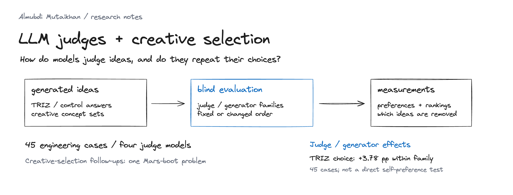
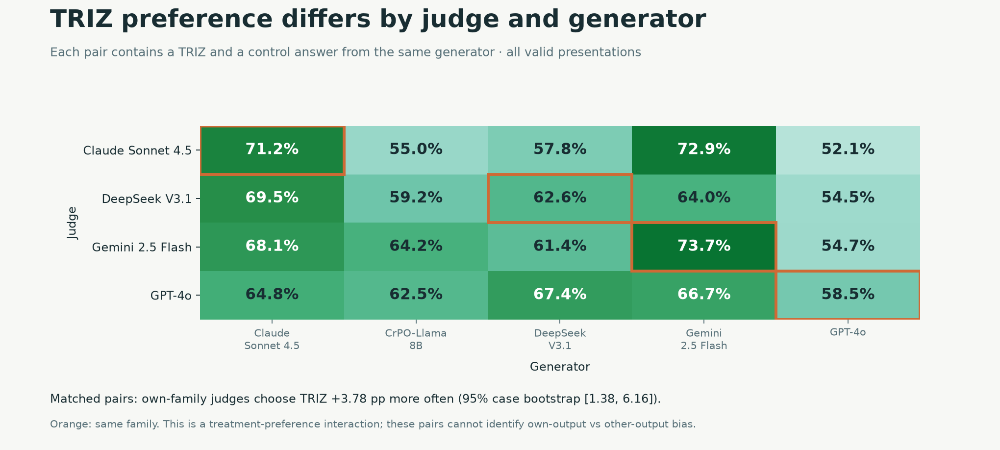
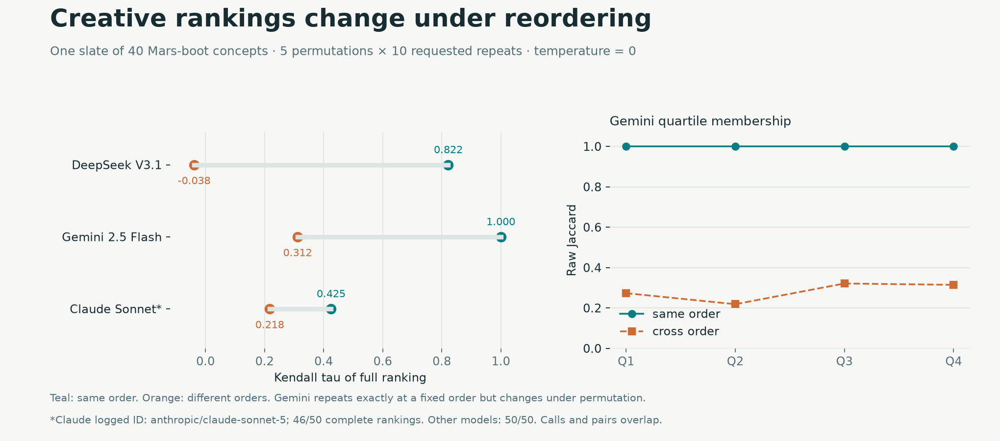
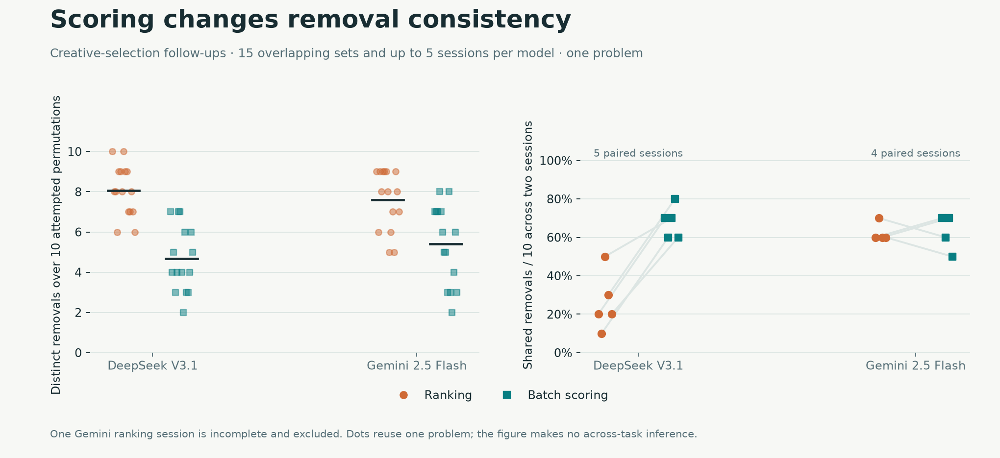

**[Almubdi Mutaikhan](https://github.com/almubdimutaikhan)** · LLM evaluation

How do models judge generated ideas, and do they repeat their choices? This project examines judge–generator relationships, candidate order, repeated rankings, and elimination by ranking or scoring.

[Results](results/RESULTS.md) · [Methods](docs/METHODS.md) · [Reproduce](docs/REPRODUCE.md) · [Data](data/README.md) · [Limitations](docs/LIMITATIONS.md)

## Judge and generator



Across 45 engineering cases, own-family judges choose TRIZ **3.78 percentage points** more often than the other three judges (95% case bootstrap **[1.38, 6.16]**). Both answers in each pair come from the same generator. This measures a treatment-preference interaction; it cannot establish own-output versus other-output self-preference. [Interpretation](docs/SELF_PREFERENCE.md).

## Repeated creative rankings



On one slate of 40 Mars-boot concepts, Gemini repeats the full ranking at a fixed order (tau **1.000**) but changes under permutation (tau **0.312**). DeepSeek’s cross-order tau is **−0.038**. These are descriptive results from one slate, with overlapping calls and candidates.

## Ranking versus scoring



Batch scoring reduces removal diversity in the tested sets. Greater consistency does not establish better ideas: the creative concepts have no gold quality labels. Missing outputs and incomplete sessions remain visible in the [results](results/RESULTS.md).

## Reproduce

Python 3.12+, no API key:

```bash
python scripts/analyze.py
python -m unittest discover -s tests -v
pip install -r requirements.txt
npm ci
npx playwright install chromium
python scripts/figures.py
```

The release contains **16,565 metadata rows** across six files. Analysis checks their hashes and rebuilds the tables offline. Only the [intro graphic](figures/overview.excalidraw) uses Excalidraw; the three result charts use Matplotlib and have [PNG and SVG exports](figures/README.md).

Source experiments: [BVSR](https://github.com/almubdimutaikhan/bvrs-llm-creativity) · [TRIZ-2AFC](https://github.com/almubdimutaikhan/triz-2afc-agent-framework). The [TRIZ prompting study](https://github.com/almubdimutaikhan/triz-llm-evaluation) shares jury records with this analysis; it is not an independent replication. [References and credit](docs/REFERENCES.md).
